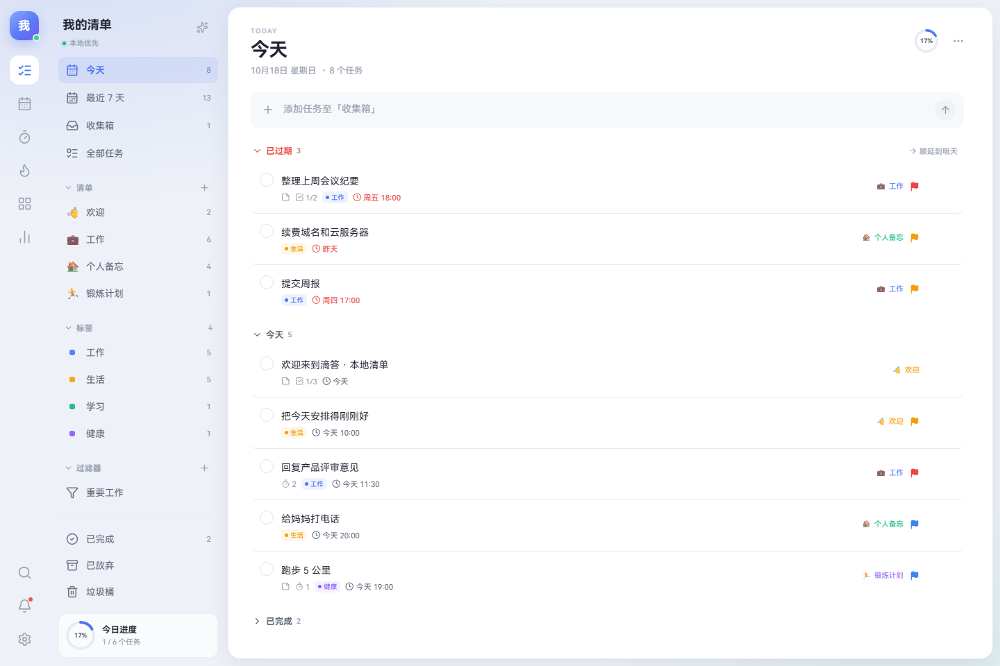
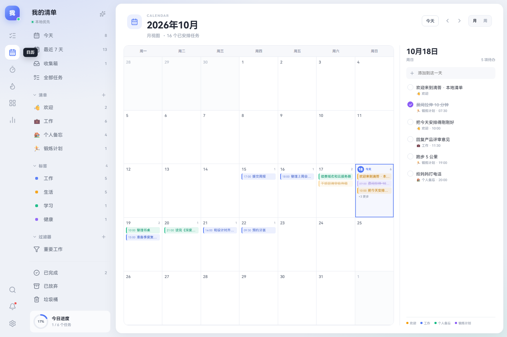
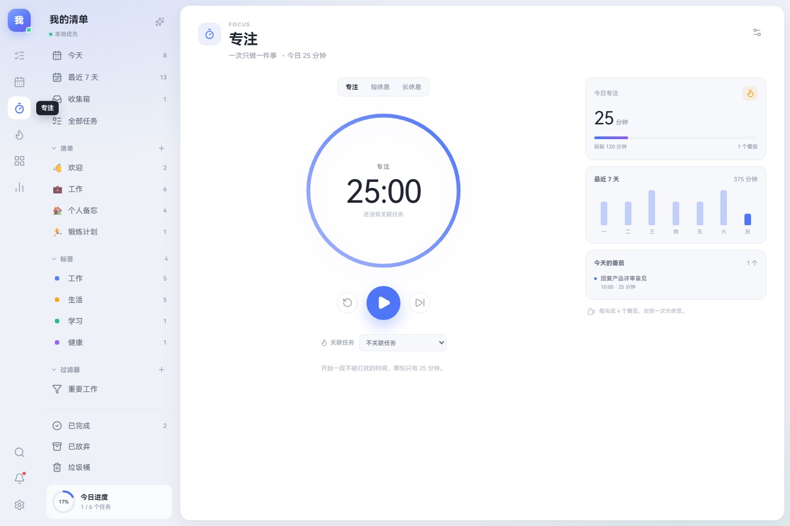
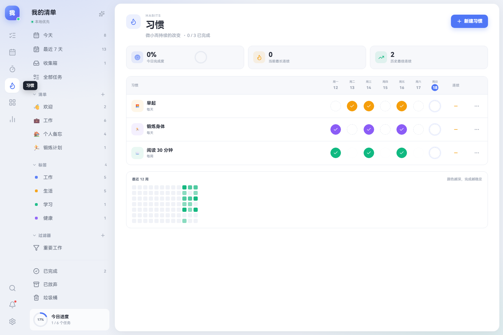
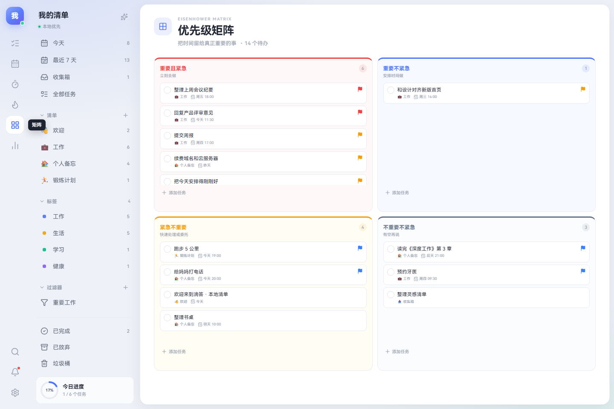
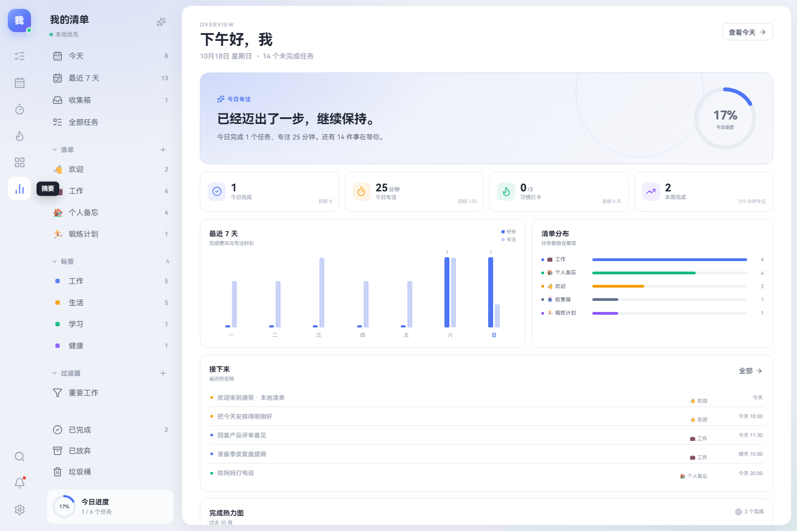
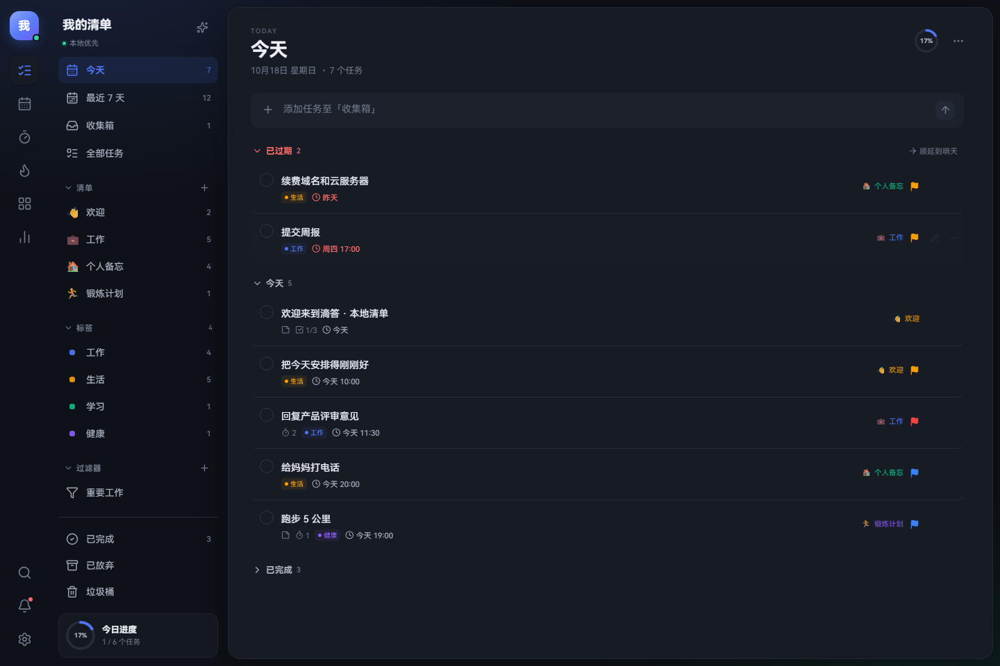
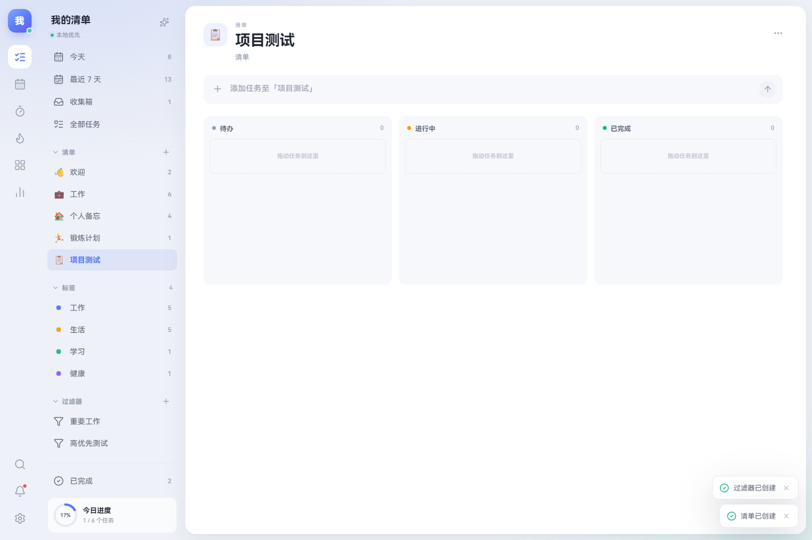

# 滴答 · 本地清单

**一个离线优先、滴答清单风格的 Windows 桌面任务管理器。**
任务、日历、番茄专注、习惯、四象限、搜索、提醒和主题都在本机运行，数据只写入本地 SQLite。

[](https://github.com/Yuxuan-THU/dida-local/releases/latest)
[](#下载与安装)
[](#技术架构)
[](LICENSE)

> **English:** Dida Local is an offline-first, TickTick-inspired task manager for Windows.
> It is an independent implementation built with Electron, React, Node.js and SQLite.
> It is **not** affiliated with TickTick/Dida365 and contains no proprietary code or assets.



---

## 目录

- [为什么做这个](#为什么做这个)
- [下载与安装](#下载与安装)
- [功能](#功能)
- [界面](#界面)
- [从源码运行](#从源码运行)
- [导入滴答清单数据](#导入滴答清单数据)
- [数据与隐私](#数据与隐私)
- [手机访问](#手机访问)
- [快捷键](#快捷键)
- [技术架构](#技术架构)
- [测试](#测试)
- [逆向分析](#逆向分析)
- [限制](#限制)
- [项目结构](#项目结构)
- [License](#license)

---

## 为什么做这个

很多任务管理工具很好用，但它们是云端的：断网、服务变更、订阅到期或团队空间调整，都会影响每天的计划。
Dida Local 的目标很直接：

- **本地优先**：不需要账号，数据存本机 SQLite，断网可用
- **桌面原生体验**：独立窗口、系统托盘、全局快捷键，不是浏览器标签页
- **保留滴答清单的使用习惯**：今天 / 最近 7 天 / 收集箱 / 清单 / 标签 / 四象限 / 番茄 / 习惯
- **能把已有数据带过来**：读取本机滴答清单数据库，支持只迁移今天及以后
- **代码可读、可改**：没有混淆，前端、服务端、数据库 schema 都是独立实现

这是一个**个人项目**，不是滴答清单官方客户端，也不包含其源代码、图标、字体或图片资源。

---

## 下载与安装

### Windows 安装版（推荐）

前往 **[Releases](https://github.com/Yuxuan-THU/dida-local/releases/latest)** 下载：

| 文件 | 说明 |
| --- | --- |
| `DidaLocal-1.0.0-x64.exe` | 安装版，创建桌面和开始菜单快捷方式 |
| `DidaLocal-Portable-1.0.0.exe` | 免安装版，双击直接运行 |

安装后可以从以下位置打开：

- 桌面上的 **滴答清单**
- 开始菜单搜索 **滴答清单**
- `%LOCALAPPDATA%\Programs\dida-local\滴答清单.exe`

> 安装包没有购买代码签名证书。Windows 首次运行时如出现 SmartScreen，
> 点击「更多信息」→「仍要运行」即可。

安装版的数据保存在：

```text
%APPDATA%\DidaLocal\data\dida.db
```

关闭窗口会缩到系统托盘；右键托盘图标可以重新打开或完全退出。
`Ctrl + Alt + D` 可以全局显示/隐藏。

### 其他平台

项目使用 Electron，可以在 macOS / Linux 上从源码运行：

```bash
npm install
npm run desktop
```

目前只提供 Windows 安装包。

---

## 功能

### 任务

- 快速添加，支持中文自然语言：
  `明天下午 3 点 交周报 !高 #工作`
- 标题、备注、子任务、优先级、标签、清单
- 日期 / 时间 / 全天、重复规则、提醒
- 完成、取消完成、删除、恢复、垃圾桶
- 双击标题内联重命名
- 列表 / 看板双视图，看板拖拽改阶段
- 拖拽排序、过期任务一键顺延
- 完成勾选动画、行折叠、分组过渡

### 视图

- 今天、最近 7 天、收集箱、全部任务、已完成、已放弃、垃圾桶
- 自定义清单（emoji、颜色、列表/看板）
- 标签汇总
- 自定义过滤器（优先级、标签、日期、状态）
- 全局搜索：任务、清单、标签、操作混合搜索
- 摘要：今日进度、7 天完成/专注趋势、清单分布、20 周热力图

### 日历

- 月视图：任务条、清单颜色、今日高亮、右侧当日任务
- 周视图：全天任务行 + 时间轴
- 拖拽任务改期
- 点击日期快速添加
- 点击任务打开详情

### 专注

- 专注 / 短休息 / 长休息
- 进度环、开始 / 暂停 / 重置 / 跳过
- 关联任务
- 今日 / 最近 7 天统计
- 完成提示音、系统通知、彩纸动效
- 计时状态持久化，刷新或切页后继续

### 习惯

- 每日 / 每周指定星期
- 一周七天打卡格、过去日期补卡
- 目标计数（例如每天 8 杯水）
- 当前连续、历史最佳、12 周热力图
- 新建 / 编辑 / 删除习惯

### 矩阵与摘要

- 艾森豪威尔四象限
- 拖动任务到其他象限，自动调整优先级和日期
- 摘要面板集中查看进度、趋势、分布和即将到来

### 外观与系统

- 浅色 / 深色 / 跟随系统
- 7 种强调色、4 种背景纹理、舒适 / 紧凑密度
- 周一开始或周日开始
- 系统通知提醒
- 响应式布局
- 所有主视图、弹窗、悬浮层都有动效，并尊重 `prefers-reduced-motion`

---

## 界面

> 以下截图使用项目自带的演示数据。

| 今天 | 日历 |
| --- | --- |
|  |  |

| 专注 | 习惯 |
| --- | --- |
|  |  |

| 四象限 | 摘要 |
| --- | --- |
|  |  |

| 深色模式 | 看板 |
| --- | --- |
|  |  |

---

## 从源码运行

### 环境

- Node.js **22.5+**（推荐 24）
- npm 10+
- Windows 10/11（开发、打包桌面版）

### 开发模式

```bash
git clone https://github.com/Yuxuan-THU/dida-local.git
cd dida-local
npm install
npm run dev
```

会同时启动 Node API 和 Vite 开发服务器，并打开 <http://127.0.0.1:4317/>。

### Electron 开发版

```bash
npm run desktop
```

### 构建 Windows 安装包

```bash
npm run pack
```

产物在 `release/`：

- `DidaLocal-1.0.0-x64.exe`
- `DidaLocal-Portable-1.0.0.exe`

### 目录与脚本

```text
npm run dev        开发模式（Vite + API）
npm run build      构建前端静态文件
npm run start      生产模式启动 Node 服务
npm run desktop    Electron 开发版
npm run pack       构建 Windows 安装包 / 便携版
npm run verify     Playwright 端到端截图验证
npm run test:core  后端 28 项核心检查
```

---

## 导入滴答清单数据

### 图形界面

1. 打开应用 → **设置 → 数据**
2. 应用会自动检测本机数据库：

   ```text
   %APPDATA%\Tick_Tick\TickTick.db
   ```

3. 选择导入范围：

   - **今天及以后**（默认）：只迁移到期日在今天及以后的任务
   - **全部历史**：迁移全部任务，包括已完成和已放弃

4. 点击导入，确认。导入前会自动备份当前数据到：

   ```text
   %APPDATA%\DidaLocal\data\backups\
   ```

导入只读取业务表（任务、清单、习惯、打卡），不会读取或上传登录 token、密码、附件。

### 命令行

```bash
npm run import:ticktick
# 导入全部历史
npm run import:ticktick -- --all
# 指定数据库
npm run import:ticktick -- "D:\path\to\TickTick.db"
```

### 字段映射

| 滴答清单 | Dida Local |
| --- | --- |
| `ProjectModel` | 清单（保留 emoji、颜色、看板视图） |
| `TaskModel.status 0 / 2 / -1` | 未完成 / 已完成 / 已放弃 |
| `TaskModel.startDate` + `isAllDay` | 到期日与全天标记 |
| `TaskModel.tag` | 标签 |
| `TaskModel.parentId` | 子任务 |
| `TaskModel.repeatFlag` | 每天 / 工作日 / 每周 / 每月 / 每年 |
| `HabitModel` + `HabitCheckInModel` | 习惯与打卡 |
| `PomodoroModel` | 专注记录 |

> 兼容性基于本机 4.3.4.0 版本的数据库结构；不同版本字段可能变化，导入前请先备份。

---

## 数据与隐私

- 安装版数据库：`%APPDATA%\DidaLocal\data\dida.db`
- 开发版数据库：`dida/data/dida.db`
- 备份目录：数据库同级的 `backups/`
- 服务默认只监听本机；手机共享模式会监听局域网并校验访问码
- 没有账号、云同步、埋点或遥测
- 备份是普通 JSON，可自行保存或迁移

---

## 手机访问

项目包含一个手机 Web/PWA 壳和 Android 薄客户端：

- 手机与电脑在同一 Wi-Fi
- 电脑端 **设置 → 手机访问**，扫码连接
- 手机和电脑共用同一份 SQLite，不需要同步
- Android 源码在 `android/`

详细步骤、安全说明和限制见 [MOBILE.md](MOBILE.md)。

> Android APK 需要自行用 Android SDK 构建；仓库不附带签名后的安装包。

---

## 快捷键

| 操作 | 快捷键 |
| --- | --- |
| 快速添加 | `Q` |
| 全局搜索 | `Ctrl / ⌘ + K` |
| 今天 | `T` |
| 日历 | `C` |
| 专注 | `F` |
| 习惯 | `H` |
| 关闭详情 / 弹窗 | `Esc` |
| 提交快速添加 | `Enter` |
| 快速添加换行 | `Shift + Enter` |
| 全局显示 / 隐藏（Electron） | `Ctrl + Alt + D` |

---

## 技术架构

```text
┌─────────────────────────────┐
│  Electron / Browser         │
│  React 19 + TypeScript      │
│  Framer Motion + lucide     │
└──────────────┬──────────────┘
               │ fetch /api/*
┌──────────────▼──────────────┐
│  Node.js HTTP server        │
│  127.0.0.1:4317             │
│  静态文件 + JSON API        │
└──────────────┬──────────────┘
               │ node:sqlite
┌──────────────▼──────────────┐
│  SQLite (WAL)               │
│  data/dida.db               │
└─────────────────────────────┘
```

- **前端**：React 19、TypeScript、Vite 7、Framer Motion、lucide-react
- **服务端**：Node.js 原生 `http` + 内置 `node:sqlite`，无原生数据库依赖
- **桌面**：Electron 39，启动内嵌 Node 服务，托盘常驻
- **数据**：单文件 SQLite，WAL 模式；完成、重复任务生成、标签重命名在事务中完成
- **测试**：Playwright + 本机 Edge，覆盖桌面与移动视口

设计取舍：

- 服务端是唯一数据源，前端所有操作都经过 API，避免“页面改了但没落盘”
- 完成、优先级等操作做乐观更新，失败回滚并提示
- 重复任务在完成时生成下一次任务，子任务自动重置
- 提醒由前端轮询，使用浏览器/系统通知

---

## 测试

```bash
npm run test:core          # 28 项后端检查
npm run test:import        # 全量导入测试
npm run test:import:future # 只导入今天及以后
npm run verify             # Playwright 桌面端截图验证
npm run verify:mobile      # 手机视口验证
npm run verify:electron    # Electron 启动/关闭验证
```

当前验证结果：

- 桌面端 1440×960 全部主视图通过，**0 console error / page error**
- 后端 28 项检查全部通过
- 真实 4.8 MB 滴答清单快照：2,880 个任务、2,645 个已完成、4 个清单、2 个习惯、60 条打卡导入通过
- `fromDate` 过滤测试确认不会导入早于今天的任务

验证截图在 [`verify-shots/`](verify-shots/)。

---

## 逆向分析

这个项目不是靠猜 UI 做的。滴答清单 Windows 版是 WPF / .NET + Kotlin Multiplatform，
不是 Electron，因此使用了三条证据链：

1. **REA** 静态分析 .NET 程序集（`TickTickHandler.dll`、`TickTickModels.dll`）
2. **SQLite schema** 与真实数据分布
3. **Windows UI Automation** 树 + 截图

REA 的命令、证据 ID、SHA-256、MVID 和限制都记录在 [REA-ANALYSIS.md](REA-ANALYSIS.md)。

> 说明：REA 的 `inspect-sqlite-database` 需要 Node.js 24.15+ 的 `DatabaseSync.limits`；
> 本项目在 Node 24.13 上改为 `node:sqlite` 只读快照 + SQL 查询交叉验证，限制已注明。

---

## 限制

这是一个本地单机版，不包含依赖云端或团队授权的功能：

- 团队共享清单、评论、@成员
- 账号登录、多端云同步
- 附件上传、日历账号（Google/Outlook）同步
- 移动端原生离线数据库与增量同步（当前是局域网 WebView 壳）
- 与官方完全一致的专有图标、插画、字体

界面是独立设计，不是官方客户端的换皮。任务数据兼容性只针对已测试的数据库版本。

---

## 项目结构

```text
dida-local/
├── src/                  React 前端
│   ├── components/       Rail / Sidebar / TaskRow / UI
│   ├── views/            Tasks / Calendar / Focus / Habits / Matrix / Summary / Settings
│   └── lib/              日期、自然语言解析、选择器、声音
├── server/               Node API + SQLite + 导入器
├── electron/             Electron 主进程（托盘、快捷键、内嵌服务）
├── public/               favicon / manifest / PWA 图标
├── assets/               独立设计的应用图标
├── android/              Android WebView 壳源码
├── scripts/              构建、启动、测试脚本
├── verify-shots/         Playwright 验证截图
├── REA-ANALYSIS.md       逆向分析记录
├── MOBILE.md             手机访问说明
└── package.json
```

---

## License

[MIT](LICENSE) © 2026 Yuxuan Su

滴答清单 / TickTick 是其各自权利人的商标。本项目与官方无关，
仅用于个人学习、数据互操作和本地效率工具实践。
